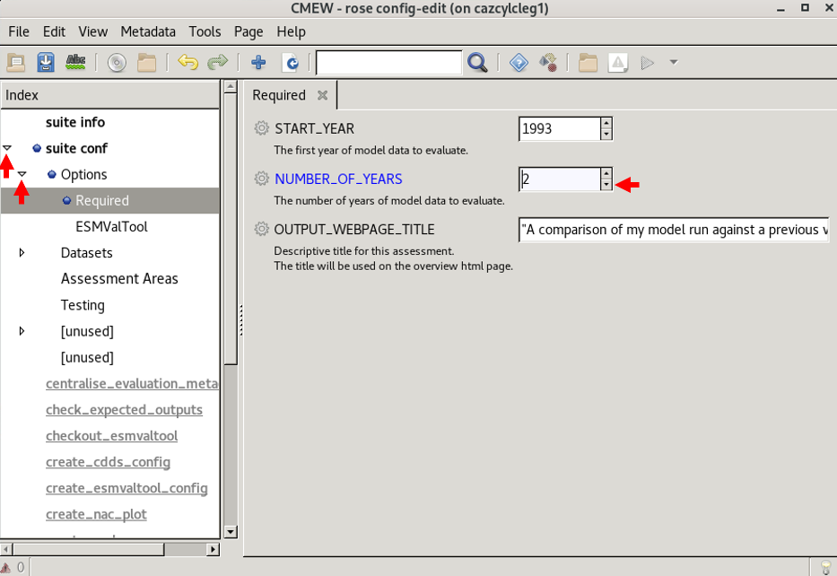

.. (C) Crown Copyright 2026, Met Office.
.. The LICENSE.md file contains full licensing details.

Configure our |CMEW| run
========================

CMEW can evaluate data from different time periods.
In this section, we will learn where the start year is determined,
and change the number of years to evaluate.

1) Navigate to the directory containing the ``rose-suite.conf`` file
--------------------------------------------------------------------

All of the code and configuration relating to the workflow is in the directory ``CMEW``.
Within the same terminal window, which is currently pointing to ``~/cmew_tutorial``,
navigate to the directory ``CMEW``::

    cd CMEW

Inspect the content of the ``CMEW`` directory::

    ls

We can confirm that files listed include ``flow.cylc`` and ``rose-suite.conf``.

2) Configure the workflow
-------------------------

This is done using the Rose GUI.
Open the Rose GUI::

    rose edit

Now we will use the GUI to change the time period options.

Note the start year
^^^^^^^^^^^^^^^^^^^

This is currently set to 1993.
This date is sufficient for this tutorial, and we will not amend it.

Change the number of years
^^^^^^^^^^^^^^^^^^^^^^^^^^

Some |CMEW| assessment areas require a minimum of five years' worth of data to run.
In order to make our tutorial quicker to run,
we will reduce the number of years to 2
and choose assessment areas that only need two years' worth of data to run.

In the GUI we need to click
 - the arrow next to **suite conf**, then
 - the arrow next to **Options**, then
 - the section labelled **Required**, then
 - the down arrow, until **2** is displayed.

         with the "Options" section expanded,
         the "Required" section selected,
         and a "2" next to variable NUMBER_OF_YEARS.
   :width: 600px

Note the value of the variable ``OUTPUT_WEBPAGE_TITLE``
^^^^^^^^^^^^^^^^^^^^^^^^^^^^^^^^^^^^^^^^^^^^^^^^^^^^^^^

This is set to *A comparison of my model run against a previous version*.
We will find this value on our outputs later on.
