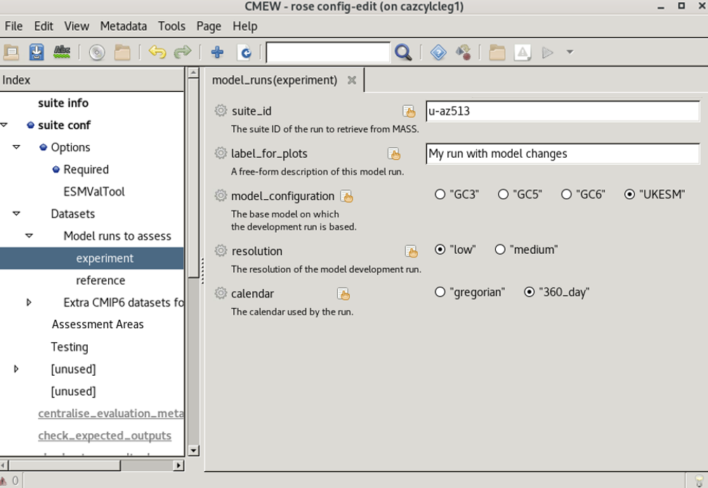

.. (C) Crown Copyright 2026, Met Office.
.. The LICENSE.md file contains full licensing details.

Change the dataset details
--------------------------

|CMEW| is set up to take a control (reference) model run,
and compare an evaluation (experiment) run to this reference.

In this section, we will use the default reference run,
but replace the experiment run with a new dataset.

A typical |CMEW| user will already know what model run they would like to assess.

For the purposes of this tutorial,
we are going to leave the reference run as it is (dataset ``u-bv526``), and
evaluate model run ``u-cw673`` as the experiment.

.. dropdown:: Information about model run ``u-cw673`` is in this dropdown.

   This information was obtained from the following address:
   https://code.metoffice.gov.uk/trac/roses-u/browser/c/w/6/7/3/trunk/rose-suite.info
   Here is a copy of the information, for ease of reference:

   .. image:: images/u-cw673_suite_info.png
      :alt: An image of a webpage showing 10 lines of code.
            The tenth line reads
            "title = GC5 N96 ORCA1 UM13.1 YR2000 present day control run".
      :width: 600px

1) Navigate to the dataset information in the Rose GUI
~~~~~~~~~~~~~~~~~~~~~~~~~~~~~~~~~~~~~~~~~~~~~~~~~~~~~~

We need to click

 - the arrow next to **Datasets**, then
 - the arrow next to **Model runs to assess**, then
 - the section labelled **experiment**.

         with the "Datasets" section expanded,
         the "Model runs to assess" section selected,
         and a pop-up menu over the "experiment" entry.
   :width: 600px

2) Enter our dataset information
~~~~~~~~~~~~~~~~~~~~~~~~~~~~~~~~

Overwrite the experiment dataset as follows:

Change the suite ID
^^^^^^^^^^^^^^^^^^^

This is the unique identifier of the model run to assess.

============  =============  ====================
Variable      Default (old)  Value to enter (new)
============  =============  ====================
``suite_id``  ``u-az513``    ``u-cw673``
============  =============  ====================

Change the label for plots
^^^^^^^^^^^^^^^^^^^^^^^^^^

This is a short description of the model run,
for example you might describe the parametrization changes.

===================  =============================  ===========================
Variable             Default (old)                  Value to enter (new)
===================  =============================  ===========================
``label_for_plots``  ``My run with model changes``  ``CMEW tutorial model run``
===================  =============================  ===========================

Change the model configuration
^^^^^^^^^^^^^^^^^^^^^^^^^^^^^^

This is used for variable mappings by |CDDS|.
In our dataset information, we can see that line 10 starts ``title=GC5 ...``.

=======================  =============  ====================
Variable                 Default (old)  Value to enter (new)
=======================  =============  ====================
``model_configuration``  ``"UKESM"``      ``"GC5"``
=======================  =============  ====================

Check the resolution
^^^^^^^^^^^^^^^^^^^^

This is used to determine memory requirements by |CDDS|.
Line 10 of the information about the model run continues ``... N96 ORCA1 ...``.

.. dropdown:: How do we know that this is low resolution?

   By clicking the help button for resolution,
   we can see that this counts as low resolution data.

   .. image:: images/resolution_help_button.png
      :alt: An image of a Rose GUI help page, displaying the following text:
            This is used to determine a model ID.
            N96 ORCA1 is low resolution.
            N215 ORCA025 is medium resolution.
      :width: 800px

==============  =============  ====================
Variable        Default (old)  Value to enter (new)
==============  =============  ====================
``resolution``  ``"low"``       ``"low"``
==============  =============  ====================

Change the calendar
^^^^^^^^^^^^^^^^^^^

The calendar is determined by the set-up of the original model run.
Model run ``u-cw673`` was set up to use a Gregorian calendar.

.. dropdown:: How do we find the calendar details?

   These details can be determined directly via MASS,
   using ``moo_ppfp`` with the ``-tim`` flag, e.g.
   ``moo_ppfp -tim :/crum/u-cw673/apm.pp/cw673a.pm1993jan.pp``.

   This returns many thousands of lines of the value ``121``.

   The value of the **last** digit, here a 1,
   tells us that the calendar is **Gregorian**.

   ==========  ============================================================
   Last digit  Calendar meaning
   ==========  ============================================================
   0           "model time", i.e. only day number, hour and minute are set.
   1           Proleptic Gregorian
   2           360-day calendar
   3           "model time", i.e. only day number, hour and minute are set.
   4           365-day calendar
   ==========  ============================================================

   |CMEW| currently only supports Gregorian and 360 day calendars.

============  =============  ====================
Variable      Default (old)  Value to enter (new)
============  =============  ====================
``calendar``  ``"360_day"``  ``"gregorian"``
============  =============  ====================

Confirm the dataset details
^^^^^^^^^^^^^^^^^^^^^^^^^^^

We have now entered new values for the variables

 - ``suite_id``,
 - ``label_for_plots``,
 - ``model_configuration``, and
 - ``calendar``

and we have confirmed that the value for

 - ``resolution``

is correct.
