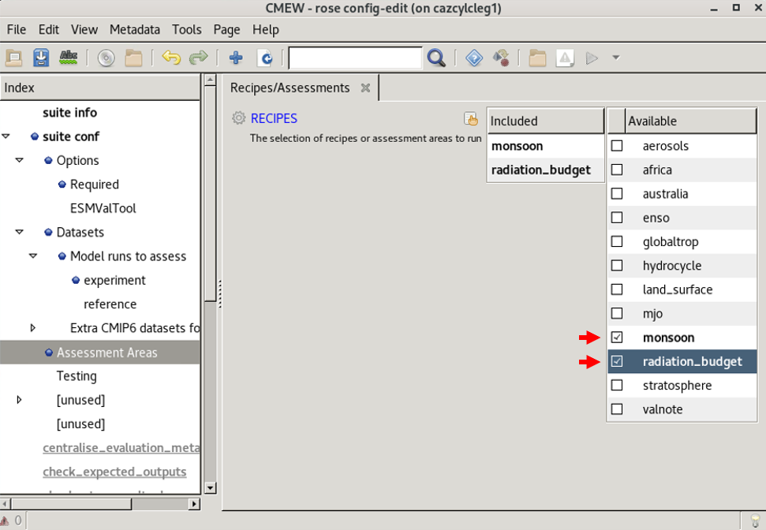

.. (C) Crown Copyright 2026, Met Office.
.. The LICENSE.md file contains full licensing details.

Choose the assessment areas
---------------------------

|CMEW| can assess multiple areas, using either ESMValTool or AutoAssess.
In this section, we will choose one assessment area from each of these tools.

1) Navigate to the Assessment Areas section in the Rose GUI
~~~~~~~~~~~~~~~~~~~~~~~~~~~~~~~~~~~~~~~~~~~~~~~~~~~~~~~~~~~

.. admonition:: In the Rose GUI, click
   :class: admonition-todo

   * the section labelled **Assessment Areas**.

2) Select the Assessment Areas to run
~~~~~~~~~~~~~~~~~~~~~~~~~~~~~~~~~~~~~

In this tutorial, we will use AutoAssess for the assessment area **monsoon**
and ESMValTool for the assessment area **radiation budget**.

All assessment areas are listed under the heading ``Available``.

.. admonition:: In the Rose GUI, tick the boxes next to
   :class: admonition-todo

   * ``monsoon``, and
   * ``radiation_budget``.

         with the "Assessment areas" section selected,
         "monsoon" and "radiation_budget" showing under the heading "Included",
         and ticks next to "monsoon" and "radiation_budget" under the heading "Available".
   :width: 600px
