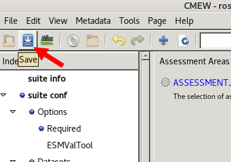

.. (C) Crown Copyright 2026, Met Office.
.. The LICENSE.md file contains full licensing details.

Start the |CMEW| workflow
-------------------------

Now we have configured |CMEW|, we are ready to set the workflow running.

1) Save the changes in the Rose GUI
~~~~~~~~~~~~~~~~~~~~~~~~~~~~~~~~~~~

In the top left corner of the Rose GUI,
click the filing cabinet icon to save the changes to the configuration.

         with an arrow pointing to the second icon from from the left
         which is displaying the pop-up text "save".
   :width: 250px

2) Use Cylc to run the workflow
~~~~~~~~~~~~~~~~~~~~~~~~~~~~~~~

We will name this run of CMEW "GC5_vs_GC3",
so that we can easily identify it even among among multiple future runs of |CMEW|.

On the command line, from the ``~/cmew_tutorial/CMEW`` directory
(the directory containing the ``flow.cylc`` file),
type the command::

    cylc vip -O metoffice --run-name GC5_vs_GC3

This will print messages from cylc about validating and installing the workflow,
and some ``[INFO]`` about the workflow.

Congratulations, we have now set the |CMEW| workflow running.
