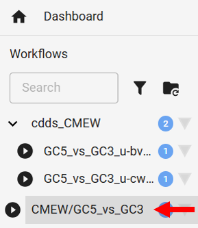

.. (C) Crown Copyright 2026, Met Office.
.. The LICENSE.md file contains full licensing details.

====================
Monitor the workflow
====================

Depending on the assessment areas, number of years,
model resolution, and state of the data on MASS,
|CMEW| may take anywhere from a few minutes to well over an hour to run.

In this section, we will use the Cylc GUI to monitor the progress of |CMEW|.

--------------------
1) Open the Cylc GUI
--------------------

In your terminal, type the command::

   cylc gui

After a few seconds, an internet browser window will open.
Unless you are already logged in, you will be prompted to enter your username and password.

Your username is of the form **firstname.lastname**.

Your password is the password you use to log on to your laptop and the VDI.

Once these details have been entered, a dashboard will display all running Cylc workflows.

------------------------------
2) Inspect the |CMEW| workflow
------------------------------

On the left hand side, you will notice a workflow called "CMEW/GC5_vs_GC3".

         of the Cylc GUI showing,
         under the heading "cdds_CMEW",
         the text "GC5_vs_GC3_u-bv526"
         and "GC5_vs_GC3_u-cw673",
         all above the text "CMEW/GC5_vs_GC3".
   :width: 200px

The "play" arrow [triangle] to the left of the workflow name indicates that the workflow is still running.

If we click the text of the workflow name
we will notice various tasks starting, running and finishing.

We can tell that the whole workflow is complete once a "stop" square replaces the triangle.
We will also notice that the text "CMEW/GC5_vs_GC3" turns grey rather than black at this time.
