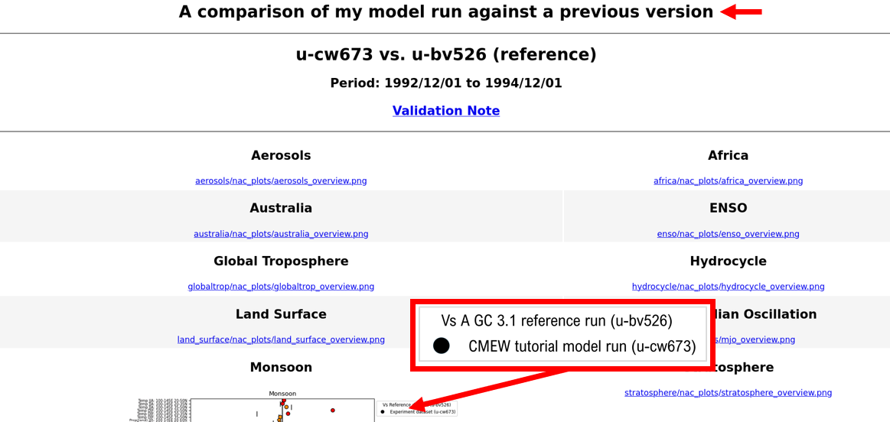
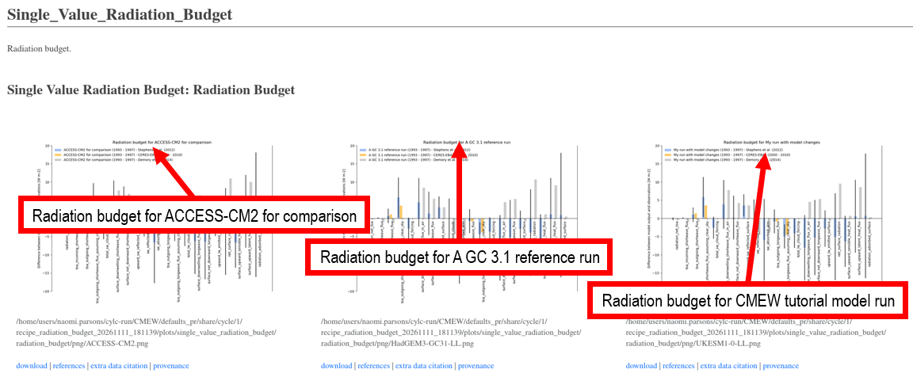

.. (C) Crown Copyright 2026, Met Office.
.. The LICENSE.md file contains full licensing details.

==================
Inspect the output
==================

|CMEW| outputs images to webpages.
The style of the pages will be determined by whether the assessment tool was AutoAssess or ESMValTool.

-------------------------------------
1) Explore the ``cylc_run`` directory
-------------------------------------

In your terminal, type the commands::

   cd ~/cylc_run/CMEW/runN/
   ls

This takes us to the directory for the most recent run of |CMEW|,
and displays the contents.

All of the output is in subdirectories of the shared directory for the cycle.
Navigate further into this directory::

   cd share/cycle/1/
   ls

We will find two subdirectories at this level:

 - ``recipe_radiation_budget_<date and time>``, and
 - ``u-cw673_vs_u-bv526``.

The first of these contains our output for the ESMValTool recipe ``radiation_budget``,
and the second contains all AutoAssess output.

------------------------------
2) Open the AutoAssess results
------------------------------

In your terminal, type the command::

   gio open u-cw673_vs_u-bv526/index.html

This will open an internet browser window,
displaying output for the AutoAssess area ``monsoon``.
No images show in the other areas,
because we did not select them in the "Assessment Areas" section of the GUI earlier on.

         "A comparison of my mode run against a previous version",
         with subtitles "u-cw673 vs. u-bv526 (reference)"
         and "1992/12/01 to 1994/12/01",
         a blue link with text "Validation Note",
         and the top of a graph under the section header "Monsoon".
         An enlargement of the graph's legend displays the text
         "Vs A GC 3.1 reference run (u-bv526), CMEW tutorial model run (u-cw673)".
   :width: 600px

We read the title *A comparison of my model run against a previous version*,
which we noted earlier in the tutorial.

We can also note that a link has been created to the Validation Note ("ValNote"),
but as we did not select ``valnote`` as an assessment area earlier,
this will not lead us to any further output.

------------------------------
3) Open the ESMValTool results
------------------------------

In your internet browser,
remove ``u-cw673_vs_u-bv526/index.html`` from the end of the address and press enter.
Now the browser will display both subfolders.

Click on the folder name ``recipe_radiation_budget_<date and time>``,
then on ``index.html``.

The browser now displays outputs for the ESMValTool recipe ``radiation_budget``.
To view the plots produced, we must scroll about two thirds of the way down the page.

         "Single_Value_Radiation_Budget",
         with three graphs displayed.
         An enlargement of each graph's title in turn displays the texts
         "Radiation budget for ACCESS-CM2 for comparison",
         "Radiation budget for A GC 3.1 reference run", and
         "Radiation budget for CMEW tutorial model run".
   :width: 600px

Here we will notice an *extra* graph, for dataset "ACCESS-CM2",
that we did not enter into our datasets section earlier on.
Let's find out where the instruction to include this dataset came from.

In your terminal, bring up the Rose GUI::

   cd ~/cmew_tutorial/CMEW
   rose edit

Navigate to the dataset information in the Rose GUI:
 - click the arrow next to **suite conf**, then
 - click the arrow next to **Datasets**, then
 - click the arrow next to **Extra CMIP6 datasets for ESMValTool**, then
 - select the option **1**.

We can confirm that dataset for the ACCESS-CM2 dataset was also present in our suite configuration.
Currently, |CMEW| will only successfully include a CMIP6 dataset in an ESMValTool recipe
if all the necessary data already exists locally.
The data for running the radiation budget recipe for the CMIP6 model ACCESS-CM2
had already been added to drives at the Met Office.

**Congratulations, you have now finished the CMEW tutorial!**
