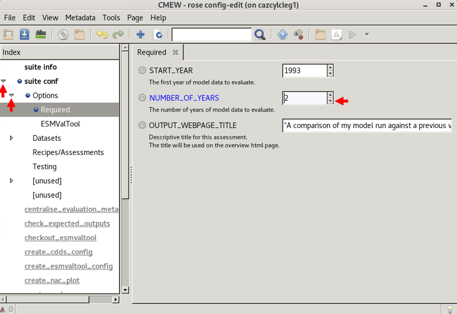
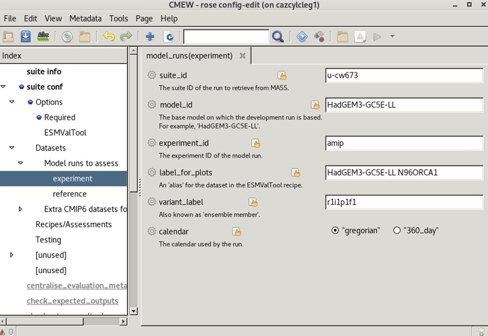

.. (C) Crown Copyright 2026, Met Office.
.. The LICENSE.md file contains full licensing details.

**********************************
Evaluating a model run with |CMEW|
**********************************

-------------------------------------------------------------------------------------------------
Comparing the radiation budget and monsoon assessment areas of a GC5 model run to a GC3 model run
-------------------------------------------------------------------------------------------------

.. include:: ../common.txt

In this tutorial,
we will put a copy of the |CMEW| workflow onto our local machine
and use it to compare model run **u-cw673** to model run **u-bv546**
with regards to radiation budget and monsoon metrics.

0. Prerequisites
----------------

a) SSH access to GitHub
b) ``moo hello``

1. Clone the |CMEW| repository from GitHub
------------------------------------------

In this section, we will copy |CMEW| from GitHub
into a directory called ``cmew_tutorial`` on the home space.

**a) Create a new directory for the |CMEW| repository**

Type the following commands into a terminal window::

    cd ~
    mkdir cmew_tutorial
    cd cmew_tutorial

**b) Obtain the |CMEW| repository from GitHub**

In your terminal, type::

    git clone git@github.com:MetOffice/CMEW.git .

We now have a copy of CMEW that we can inspect and run.

Let's look at the |CMEW| repository.
Within the same terminal window, type::

    ls

We can confirm that the following have been created inside our directory `cmew_tutorial`:
 - ``CMEW`` (a directory)
 - ``CODE_OF_CONDUCT.md`` (a document)
 - ``doc`` (a directory)
 - ``README.md`` (a document)
 - ``SUPPORT.md`` (a document)
 - ``CONTRIBUTING.md`` (a document)
 - ``LICENSE.md`` (a document)
 - ``SECURITY.md`` (a document)

2. Configure the datasets for our |CMEW| run
--------------------------------------------

|CMEW| is set up to take a reference (control) model run,
and compare an evaluation (experiment) run to this reference.

In this section, we will use the default control run,
but replace the experiment run with a new dataset.

**a) Navigate to the directory containing the** ``rose-suite.conf`` **file**

All of the code and configuration relating to the workflow is in the directory ``CMEW``.
Navigate to the directory ``CMEW``::

    cd CMEW
    ls

We can confirm that files listed include ``flow.cylc`` and ``rose-suite.conf``.

**b) Configure the workflow**

This is done using the Rose GUI.
Open the Rose GUI::

    rose edit

Now we will use the GUI to change some options.

**i) Change the number of years**

Some |CMEW| assessment areas require a minimum of five years' of data to run.
For this tutorial, we will pick areas that only need two years' worth of data to run.
In order to make our tutorial run quicker, we will reduce the number of years to 2.

In the GUI we need to click
 - the arrow next to **suite conf**, then
 - the arrow next to **Options**, then
 - the section labelled **Required**, then
 - the down arrow, until **2** is displayed.

         with the "Datasets" section expanded,
         the "Model runs to assess" section selected,
         and a pop-up menu over the second entry.
   :width: 600px

**ii) Change the experiment dataset details**

Now in the GUI we need to click
 - the arrow next to **Datasets**, then
 - the arrow next to **Model runs to assess**, then
 - the section labelled **experiment**.

         with the "Datasets" section expanded,
         the "Model runs to assess" section selected,
         and a pop-up menu over the second entry.
   :width: 600px

Overwrite the experiment dataset with the following details:
 - s
