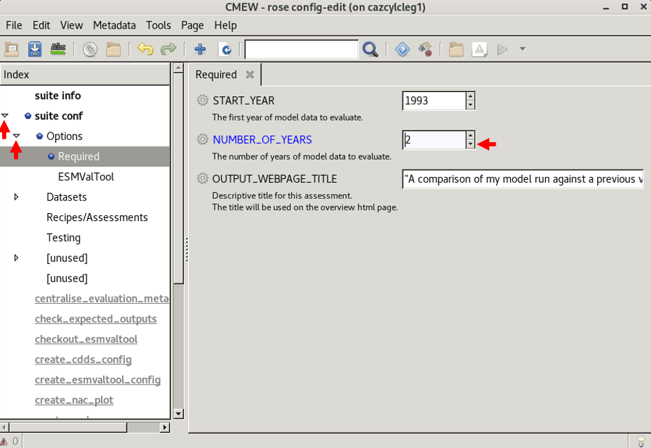

.. (C) Crown Copyright 2026, Met Office.
.. The LICENSE.md file contains full licensing details.

**********************************
Evaluating a model run with |CMEW|
**********************************

-------------------------------------------------------------------------------------------------
Comparing the radiation budget and monsoon assessment areas of a GC5 model run to a GC3 model run
-------------------------------------------------------------------------------------------------

.. include:: ../../common.txt

2. Configure the datasets for our |CMEW| run
--------------------------------------------

|CMEW| is set up to take a reference (control) model run,
and compare an evaluation (experiment) run to this reference.

In this section, we will use the default control run,
but replace the experiment run with a new dataset.

**a) Navigate to the directory containing the** ``rose-suite.conf`` **file**

All of the code and configuration relating to the workflow is in the directory ``CMEW``.
Navigate to the directory ``CMEW``::

    cd CMEW
    ls

We can confirm that files listed include ``flow.cylc`` and ``rose-suite.conf``.

**b) Configure the workflow**

This is done using the Rose GUI.
Open the Rose GUI::

    rose edit

Now we will use the GUI to change some options.

**i) Change the number of years**

Some |CMEW| assessment areas require a minimum of five years' of data to run.
For this tutorial, we will pick areas that only need two years' worth of data to run.
In order to make our tutorial run quicker, we will reduce the number of years to 2.

In the GUI we need to click
 - the arrow next to **suite conf**, then
 - the arrow next to **Options**, then
 - the section labelled **Required**, then
 - the down arrow, until **2** is displayed.

         with the "Options" section expanded,
         the "Required" section selected,
         and a "2" next to variable NUMBER_OF_YEARS.
   :width: 600px
