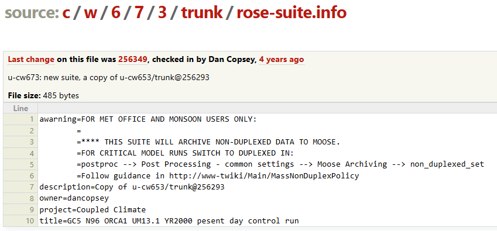
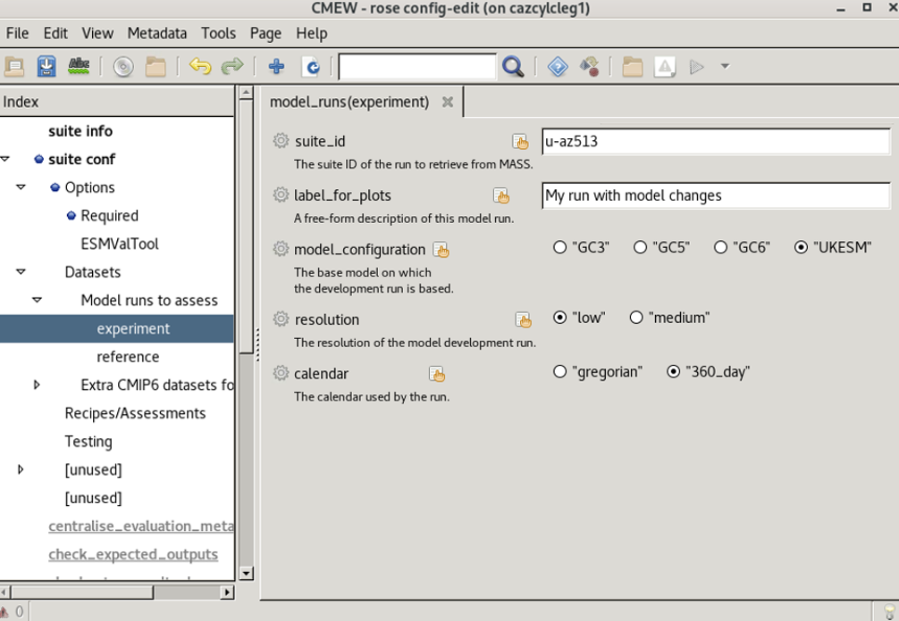

.. (C) Crown Copyright 2026, Met Office.
.. The LICENSE.md file contains full licensing details.

.. include:: ../../common.txt

Change the dataset details
--------------------------

|CMEW| is set up to take a reference (control) model run,
and compare an evaluation (experiment) run to this reference.

In this section, we will use the default control run,
but replace the experiment run with a new dataset.

A typical |CMEW| user will already know what model run they would like to assess.

For the purposes of this tutorial,
we are going to leave the reference run as it is (dataset ``u-bv526``), and
evaluate model run ``u-cw673`` as the experiment.

Information about this model run can be found at the following address:
https://code.metoffice.gov.uk/trac/roses-u/browser/c/w/6/7/3/trunk/rose-suite.info

Here is a copy of the information, for ease of reference:

         with the "Datasets" section expanded,
         the "Model runs to assess" section selected,
         and a pop-up menu over the "experiment" entry.
   :width: 600px

Now in the GUI we need to click
 - the arrow next to **Datasets**, then
 - the arrow next to **Model runs to assess**, then
 - the section labelled **experiment**.

         1	awarning=FOR MET OFFICE AND MONSOON USERS ONLY:
         2	        =
         3	        =**** THIS SUITE WILL ARCHIVE NON-DUPLEXED DATA TO MOOSE.
         4	        =FOR CRITICAL MODEL RUNS SWITCH TO DUPLEXED IN:
         5	        =postproc --> Post Processing - common settings --> Moose Archiving --> non_duplexed_set
         6	        =Follow guidance in http://www-twiki/Main/MassNonDuplexPolicy
         7	description=Copy of u-cw653/trunk@256293
         8	owner=dancopsey
         9	project=Coupled Climate
         10	title=GC5 N96 ORCA1 UM13.1 YR2000 pesent day control run
   :width: 600px

Overwrite the experiment dataset with the following details:

**suite_id**

This is the main identifier of the model run to assess,
informing where the data on MASS will be extracted from.

*Enter the value*
 - ``u-cw673``

**label_for_plots**

This is a short description of the model run,
for example you might describe the parametrization changes.

*Enter the value*
 - ``CMEW tutorial model run``

**model_configuration**

Line 10 of the information about the model run starts ``title=GC5 ...``.

*Select the option*
 - ``"GC5"``

**resolution**

Line 10 of the information about the model run continues ``... N96 ORCA1 ...``.

.. dropdown:: How do we know that this is low resolution?

   By clicking the help button for resolution,
   we can see that this counts as low resolution data.

   .. image:: images/resolution_help_button.png
      :alt: An image of a Rose GUI help page, displaying the following text:
            This is used to determine a model ID.
            N96 ORCA1 is low resolution.
            N215 ORCA025 is medium resolution.
      :width: 800px

*Select the option*
 - ``"low"``

**calendar**

This model run was set up to use a 360 day calendar.

.. dropdown:: How do we find the calendar details?

   These details can be determined directly via MASS,
   using ``moo_ppfp`` with the ``-tim`` flag, e.g.
   ``moo_ppfp -tim :/crum/u-cw673/apm.pp/cw673a.pm1993jan.pp``.

   This returns many thousands of lines of the value ``121``.

   The value of the **last** digit, here a 1,
   tells us that the calendar is **Gregorian**.

   0 = "model time", i.e. only day number, hour and minute are set.
   1 = Proleptic Gregorian
   2 = 360-day calendar
   3 = "model time", i.e. only day number, hour and minute are set.
   4 = 365-day calendar

   |CMEW| currently only supports Gregorian and 360 day calendars.

*Select the option*
 - ``"gregorian"``
