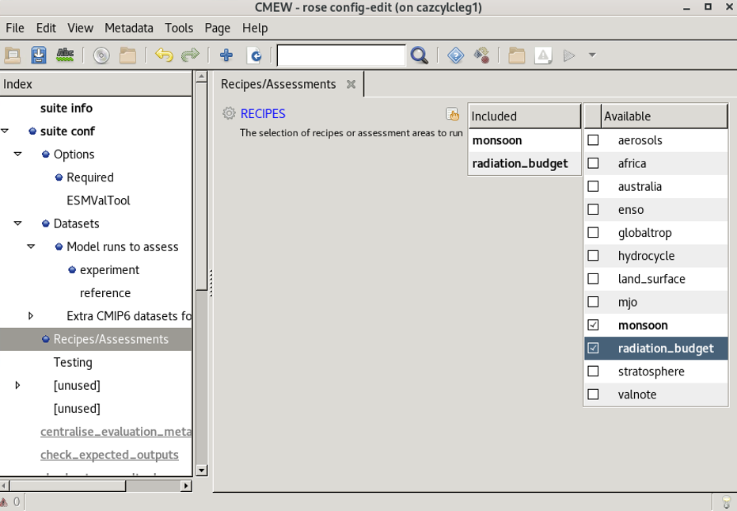

.. (C) Crown Copyright 2026, Met Office.
.. The LICENSE.md file contains full licensing details.

.. include:: ../../common.txt

===========================
Choose the assessment areas
===========================

|CMEW| can assess multiple areas, using either ESMValTool or AutoAssess.
In this section, we will choose one assessment area from each of these tools.

-----------------------------------------------------------
1) Navigate to the Assessment Areas section in the Rose GUI
-----------------------------------------------------------

We need to click
 - the section labelled **Assessment Areas**.

         with the "Assessment areas" section selected,
         "monsoon" and "radiation_budget" showing under the heading "Included",
         and ticks next to "monsoon" and "radiation_budget" under the heading "Available".
   :width: 600px

-------------------------------------
2) Select the Assessment Areas to run
-------------------------------------

In this tutorial, we will use AutoAssess for the assessment area **monsoon**
and ESMValTool for the assessment are **radiation budget**.

Under the heading ``Available``, tick the boxes next to

 - ``monsoon``, and
 - ``radiation_budget``.
